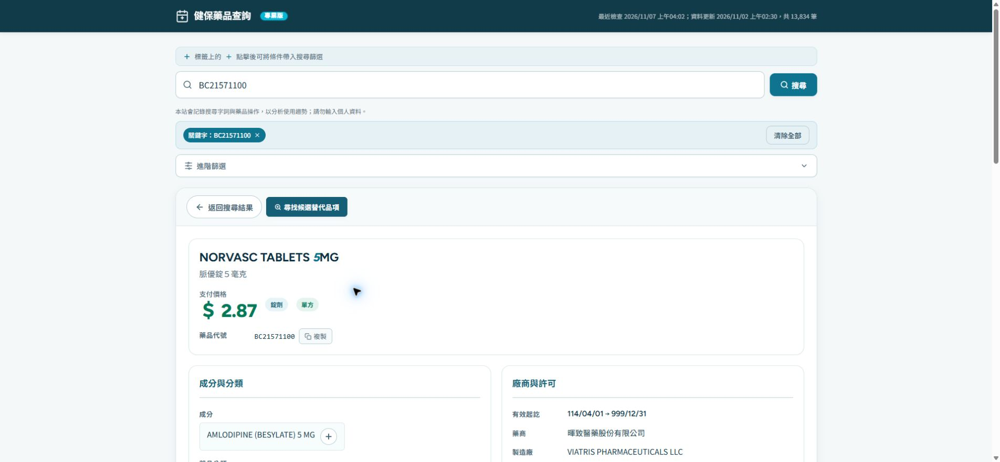
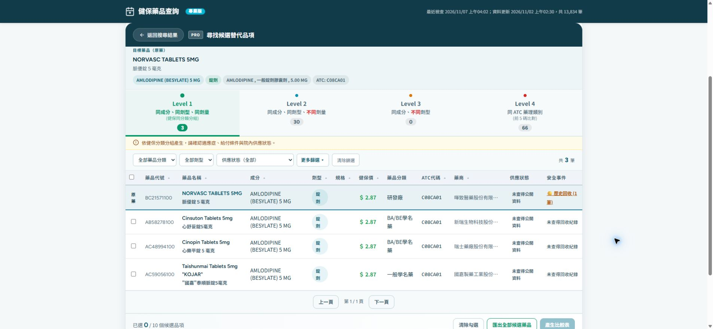
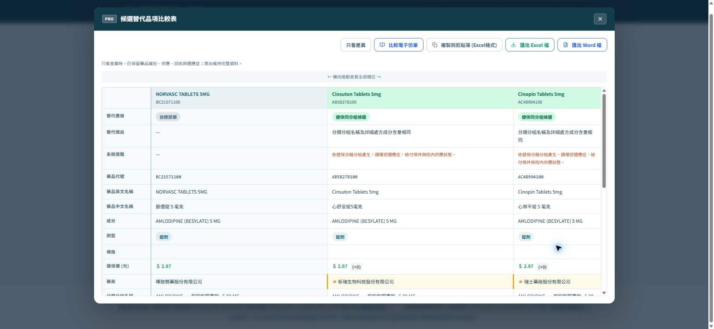

# 缺藥替代藥品決策支援平臺

當院內某項藥品缺貨時，藥師需要先確認缺貨品項的成分、劑型與規格，再判斷有哪些候選藥品值得進一步查核。本平臺整合臺灣健保藥品資料、食藥署藥品供應與回收資訊及電子仿單，協助藥師在同一個流程中搜尋、篩選與比較候選品項。

## 藥師如何使用

1. 輸入商品名、成分名或健保代碼，確認原藥的劑型與規格。
2. 選擇「尋找候選替代品項」，先查看各層級的候選清單。
3. 依評估需要篩選品項，勾選想深入比較的藥品，再產生同類藥品比較表。
4. 核對成分、規格、健保價、適應症與仿單，再向院內採購或供應商確認實際可取得的品項。需要與團隊討論時，可匯出比較結果。

## 候選清單怎麼讀

| 層級 | 篩選依據 |
| --- | --- |
| Level 1 | 同成分、同劑型、同規格強度 |
| Level 2 | 同成分、同劑型、不同規格強度 |
| Level 3 | 同成分、不同劑型 |
| Level 4 | 依所選 ATC 分類範圍尋找同類藥品 |

層級表示候選品項與原藥的相似條件。個別病人的替代適切性仍由醫療團隊依適應症、劑量、給藥途徑及病人狀況評估。供應公告與院內即時庫存需分別確認。

## 操作示例｜NORVASC 5 mg

以下三張圖取自 2026 年 11 月 7 日專業版的操作紀錄。候選數量反映當日的資料與篩選條件。

**1. 選定原藥。** 搜尋 NORVASC 或健保碼 `BC21571100`，確認品項為 NORVASC TABLETS 5MG，再點選「尋找候選替代品項」。

**2. 查看分層候選。** 本例 Level 1 有 3 項、Level 2 有 30 項、Level 3 有 0 項、Level 4 有 66 項（ATC 前 5 碼）。藥師可先檢視 Level 1，再依劑型、BA/BE 分類、供應公告或歷史回收紀錄縮小清單。

**3. 勾選並比較。** 選取心舒妥與心樂平，和原藥並列比較成分、劑型、健保資訊及藥商。進一步核對電子仿單時，該次畫面顯示心樂平缺少電子仿單資訊，藥師可據此辨認仍需另行查證的品項。

## 研究結果｜以食藥署官方替代建議回溯驗證

研究從 251 筆短缺公告中找到 227 筆可對應健保品項的公告，依「公告 × 原藥健保碼」形成 575 筆測試紀錄。其中 513 筆可擷取官方建議替代藥品的許可證字號，供命中率比對。原研究的 Level 4 採 ATC 前 5 碼。

| 評估項目 | 結果 | 如何解讀 |
| --- | --- | --- |
| 候選涵蓋率（Level 1–4） | 570／575（99.13%） | 一筆紀錄只要找到至少一個候選，即計入涵蓋。 |
| 官方建議品項累積命中率 | Level 1 為 307／513（59.84%），擴至 Level 1–3 為 355／513（69.20%），擴至 Level 1–4 為 428／513（83.43%） | 依許可證比對，計算候選清單至少包含一項官方建議品的紀錄比例。 |
| 每筆測試紀錄的平均候選件數 | 135.87 項（575 筆） | 原研究加總四層件數，跨層可能重複。 |
| 摘要函式內部處理時間 | 中位數 120 ms，第 95 百分位數 280 ms，99.5% 於 1 秒內完成 | 計時範圍限於函式內部。完整 API 往返時間及藥師實際作業時間仍待量測。 |

操作案例與研究資料各有用途：前者示範如何從候選清單走到品項比較，後者評估平臺能否找回公告列出的建議品項。個別候選的臨床適切性仍需由藥師評估。

## 試用方式

平臺採邀請制試用。受邀藥師請依邀請通知取得入口與操作說明，遇到問題可直接回覆邀請人，註明查詢品項、操作步驟及畫面上看到的結果。請使用藥品資料描述問題，並省略病人識別資訊。

## 關於本專案

本儲存庫提供專案介紹與操作文件。平臺原始碼採閉源維護。
